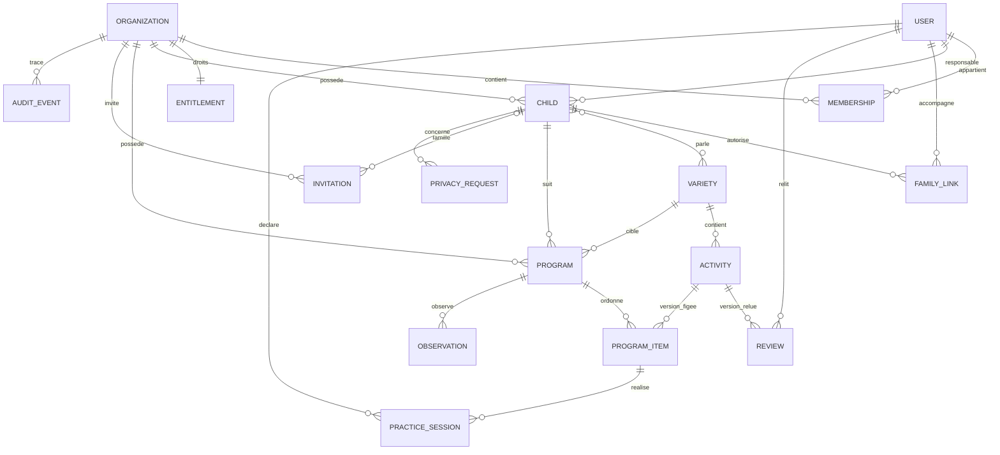

# Conception et périmètre de Nehdrou

État au 9 octobre 2026. Le fichier de cadrage est une source d’exigences, non une autorisation de lancement. La demande « réaliser le projet » autorise l’implémentation locale. Cette livraison est une première version démontrable ; les validations externes ci-dessous ne sont pas acquises.

## 1. Produit et hypothèses

**Décision de conception :** monolithe Django destiné au praticien et à l’accompagnant. L’enfant est un profil, sans compte autonome. Un cabinet possède les dossiers ; chaque dossier a un responsable. Les programmes portent sur une variété parlée déterminée. Aucun résultat du jeu n’est interprété comme qualité de parole, diagnostic, acquisition dans une autre langue ou progrès conversationnel.

**Cadrage clinique à relire :** public initial de 4–7 ans évalué par un professionnel ; choix des contrastes et de l’approche par celui-ci. Les approches motrices, neurologiques, oppositions multiples et autres besoins ne sont pas automatiquement pris en charge. La démonstration utilise des mots illustratifs, explicitement non validés comme paires minimales.

**Hypothèses commerciales :** praticien indépendant ou petit centre comme payeur ; famille incluse dans le quota de profils actifs ; prix de 15, 19 ou 29 EUR à tester, aucune offre arrêtée. Les devises, pays et langues sont indépendants. Aucun entretien, client payant, renouvellement ou revenu n’est présumé acquis.

**Première livraison recommandée :** démonstration fictive de bout en bout, puis pilote limité à une variété relue. Les trois interfaces peuvent être disponibles avant que les trois catalogues cliniques le soient.

## 2. Parcours et permissions

Parcours professionnel : inscription → cabinet → profil pseudonymisé et variétés → sélection d’activités → programme et rythme → invitation neutre → retours → observation → clôture ou nouveau programme → export.

Parcours familial : invitation temporaire → création de compte ou connexion au courriel invité → langue des consignes → seul profil lié → découverte des mots → choix d’image → échange accompagné → réalisation ou arrêt → commentaire → support imprimable.

Parcours éditorial : import brouillon → documentation des droits et publics → relecture clinique et linguistique de la version exacte → publication par acteur habilité → nouvelle version pour correction → retrait éventuel et repérage des programmes liés.

| Rôle | Droits livrés | Frontière |
|---|---|---|
| Responsable de cabinet | Membres, invitations professionnelles, lecture des droits commerciaux | Pas de lecture clinique automatique ; doit être responsable du dossier pour le lire |
| Praticien | Création et lecture de ses profils, programmes, observations, invitations familiales, exports | Adhésion active et responsabilité exigées ; pas d’accès aux autres praticiens |
| Accompagnant | Profils explicitement liés, programmes, pratiques, supports, exports familiaux | Aucun accès aux observations professionnelles ni à la gestion du cabinet |
| Éditeur local | Catalogue et médias éditoriaux dans Django admin | Aucun modèle clinique enregistré dans admin |
| Relecteur | Modèle de relecture et permission dédiée ; propres relectures dans admin | Attribution par variété et qualification du relecteur à compléter avant pilote |
| Administrateur technique | Comptes, organisations, droits manuels, audit, demandes de données | Superutilisateur distinct du rôle applicatif ; admin désactivé hors développement |

La révocation est relue à chaque accès serveur, y compris impression et export. Une session authentifiée existante ne maintient pas un droit familial révoqué. Une invitation ne réactive pas un accès sans lien explicite avec le même courriel. L’admission d’un praticien est transactionnelle et respecte le quota.

Un accès de support exceptionnel devra être temporaire, justifié, validé par le cabinet, limité à un dossier, journalisé et révoqué. Aucun mécanisme d’accès de support clinique n’est livré. Un superutilisateur disposant d’un accès direct à la base reste un privilège technique : le déploiement doit le limiter et l’auditer séparément.

## 3. Architecture et décisions

```
config/       paramètres, routes, WSGI
core/         comptes, organisations, invitations, droits, audit, accès, formulaires et vues
catalog/      variétés, versions d’activités, relectures, import et admin éditorial
care/         profils, liens familiaux, programmes, pratique et observations
locale/       catalogues gettext fr/en/ar, sources PO et MO
static/       CSS responsive et illustrations originales
 templates/   pages serveur et lecteur commun
 docs/        conception, recette, exploitation
```

Le choix de trois applications métier regroupe les fonctions commerciales et la traçabilité dans `core`, sans créer six petits modules de couplage équivalent. Les activités comportent un moteur commun de trois étapes plutôt qu’un composant par langue. Les mots, illustrations, modèles audio et consignes viennent des versions de contenus. Pas d’API générale, application native, microservice ni file de tâches distribuée dans cette version.

**Faits techniques vérifiés :** Django 5.2 est LTS et le correctif 5.2.18 est annoncé sur la page officielle ; Python 3.12 figure dans ses versions compatibles. Les versions des dépendances sont fixées et les distributions ont été vérifiées par SHA-256. La machine de recette utilise Python 3.12.4 ; actualiser le correctif Python avant production. PostgreSQL 17 est la cible configurée ; la recette actuelle utilise SQLite, faute de PostgreSQL ou Docker installé.

Les écritures critiques passent par `core.services` : admission d’invitation, quota et attribution, enregistrement idempotent de pratique. Les transactions et verrous du cabinet sérialisent les admissions et quotas ; le verrou utilisateur sérialise les retransmissions de sessions. `core.access` centralise les ensembles d’objets visibles. Les modèles exécutent `full_clean()` lors de `save()` et les contraintes uniques restent en base. Les opérations SQL brutes, `bulk_create()` et `QuerySet.update()` contournent ces validations applicatives ; les utiliser sur les relations cliniques est interdit dans le code métier. Ajouter des contraintes composites ou triggers si des intégrations écrivent directement dans la base.

Pagination : profils par 20, catalogue par 12 ; tableaux de bord limités à six éléments ; historique affiché limité à 30 derniers retours, export complet. Les FK disposent d’index ; index supplémentaires variété/état et cabinet/date. `select_related` et `prefetch_related` maîtrisent les listes et exports. Le texte des instructions est local ; les médias audio ne sont pas préchargés. Coût faible pour un petit pilote. Mesurer les requêtes et la taille de l’export avant un changement d’échelle ; un export asynchrone ne se justifie qu’après observation de volumes réels.

## 4. Modèle relationnel



Les mots et médias sont incorporés à la version `Activity`, plutôt que partagés par des tables de mots susceptibles de changer l’historique. Cette rationalisation est adaptée à un petit catalogue ; une future réutilisation lexicale devra conserver des versions explicites. La paire clinique n’est pas déduite d’une comparaison de lettres. Deux termes d’une activité partagent une seule variété ; le relecteur atteste la pertinence phonologique.

### Dictionnaire de données

| Entité | Champs principaux et relations | Contraintes / portée / conservation |
|---|---|---|
| User | username, email, hash de mot de passe, langue de consignes | Courriel unique sans distinction de casse ; compte global ; identifiants techniques natifs Django |
| Organization | UUID, nom, pays, date | Racine des données métier ; pays indépendant de la langue et devise |
| Membership | UUID, cabinet, utilisateur, rôle, actif | Un lien par cabinet/utilisateur ; retrait effectif sans destruction des dossiers |
| Entitlement | cabinet, plan, quotas, état, échéance, montant, devise, référence | Un par cabinet ; décimal, sans carte bancaire ; aucune suppression à échéance |
| Child | UUID, cabinet, code, âge en années, responsable, variétés, actif | Code unique par cabinet ; âge 4–7 ; responsable membre actif à l’écriture ; ni nom légal ni date de naissance |
| FamilyLink | enfant, utilisateur, actif | Lien unique ; cabinet dérivé de l’enfant ; révocation conservée |
| Invitation | cabinet, enfant optionnel, type, courriel, hash de jeton, échéance, révoquée, utilisée, auteur | Famille exige enfant du même cabinet ; praticien sans enfant ; jeton aléatoire, jamais conservé en clair en base |
| Variety | code stable, langue, libellé, périmètre | Codes `fr-fr-pilot`, `en-us-general-pilot`, `ar-dz-pilot` ; couverture démonstrative uniquement |
| Activity | UUID, série, version, variété, contraste, deux mots/transcriptions/images/audios, consignes JSON, droits, public, limites, état, demo | Unique série/version ; version publiée immuable sauf retrait ; hors mode démo, exemples exclus des attributions |
| Review | activité, relecteur, type, accord, note, empreinte, date | Relecture de contenu soumis ; publication réelle exige les deux types sur l’empreinte exacte |
| Program | cabinet, enfant, variété, auteur, titre, consignes, rythme, état | Cabinet cohérent et variété enregistrée chez l’enfant ; identité fixe après attribution |
| ProgramItem | programme, activité/version, position | Position unique ; variété compatible ; contenu publié à attribution |
| PracticeSession | cabinet, élément, auteur/rôle, clé idempotente, digest, cible/réponse, correct nullable, participation, déclaration, commentaire, date | Clé unique par auteur ; correction serveur ; arrêt sans note ; cabinet cohérent ; pas de voix |
| Observation | programme, professionnel, texte, date | Observation distincte ; lecture limitée au responsable actif |
| AuditEvent | cabinet optionnel, acteur, action, ID objet, date | Aucun commentaire, jeton ou contenu clinique ; catalogue global sans cabinet |
| PrivacyRequest | cabinet, enfant, demandeur, type, état, date | Cohérence cabinet/enfant ; traitement manuel documenté |
| RateWindow | clé hachée, compteur, date | Protection technique des POST sensibles ; purge des fenêtres obsolètes après un jour |

FK des dossiers et versions avec `PROTECT` : suppression irréfléchie bloquée. Ne pas activer de purge clinique sans durée et procédures validées. La pseudonymisation n’est pas l’anonymisation ; compte et liens peuvent réidentifier l’enfant. Conservation par cabinet à paramétrer après analyse applicable ; la démonstration ne fait aucune promesse de durée réglementaire.

### Invariants vérifiables

1. UUID et contrôle d’objet sont deux mécanismes distincts. La vue ne charge que les objets autorisés.
2. Cabinet de l’enfant, programme, invitation et session cohérent ; membre responsable actif à la création.
3. Famille explicitement liée, jamais simple accès par identifiant fourni.
4. Version attribuée fixe ; changement des mots, médias ou consignes publiés rejeté ; retrait rend l’activité indisponible et garde les retours.
5. Relecture phonologique et linguistique réelle requise ; une modification après relecture invalide son empreinte.
6. Participation, réponse de tâche et observation clinique distinctes ; identité/rôle/date de déclaration préservés.
7. Répétition réseau identique retourne la même session ; répétition avec données différentes rejetée.
8. Arrêt sans réponse : `correct=null`, exclu du dénominateur des réponses.
9. Expiration bloque création et attribution, sans effacement ni suppression d’export. Programmes existants restent utilisables sauf retrait ou clôture.
10. Montant décimal et devise ; fiscalité et fournisseur de paiement séparés de l’accès.

## 5. Langues et édition

Interface : gettext Django + cookie de langue + LocaleMiddleware. Consignes : préférence séparée sur le compte. Activité : variété fixe sur le programme et ses contenus. Un parent peut donc utiliser une interface arabe, des consignes arabes et un programme français. Une traduction de mots n’est jamais utilisée pour créer une paire dans une autre langue.

Les contenus définissent consignes `fr/en/ar`. Aucune consigne manquante n’est remplacée silencieusement ; la vue affiche l’indisponibilité. Les jeux de mots restent dans leur langue, même sur une interface d’une autre direction. `bdi`, `dir=auto`, direction explicite des courriels, propriétés CSS logiques, figures non inversées et CSS d’impression prennent en charge les textes mixtes. Les noms de variétés et contenus gardent leur identité clinique. Faire relire les traductions de l’interface et tester les lecteurs d’écran arabes avant le pilote.

États cibles : brouillon → relecture → approuvé → publié → retiré. Les états existent dans l’admin local. Les conditions matérielles de publication sont contrôlées ; une publication réelle exige droits, population, toutes les consignes, illustrations, audio/transcriptions et deux relectures de l’empreinte courante. L’import est toujours brouillon. La machine d’états complète avec validations de rôle par langue et historique de chaque revue reste un lot de durcissement. La démo n’accorde aucune validation clinique.

Un contenu comprend des droits pour tous les médias. Les URLs audio seront hébergées sur un domaine éditorial maîtrisé, sans données privées dans l’URL. Évaluer le modèle naturel et l’autorisation de diffusion ; ne pas adopter une voix synthétique comme modèle phonétique sans évaluation. Le système livré utilise deux illustrations originales, aucune récupération d’image ou voix sur Internet.

## 6. Écrans et expérience

| Écran | But / données / actions | Validation / droits / états |
|---|---|---|
| Présentation | Positionnement, périmètre, accès | Aucune revendication de preuve ou prix acquis ; liens de connexion et inscription |
| Inscription / connexion | Cabinet, compte, mot de passe | Validateurs Django, CSRF, limitation ; erreur sans dossier exposé ; récupération neutre |
| Tableau de bord | Compteurs autorisés, programmes, derniers retours | Cabinet courant ; état vide avec prochaine action ; jamais compteur d’un autre cabinet |
| Profils / fiche | Pseudonyme, âge, variétés, programmes, liens | 4–7 ans ; quota ; responsabilités ; révocation POST ; exports contrôlés |
| Bibliothèque / activité | Filtres, variété, contraste, mots/médias, version, limites | Publié et disponible ; filtre vide explicite ; aucune substitution entre langues |
| Composition | Titre, variété, activités, consignes et rythme | Variété du profil ; toutes activités compatibles ; publication et droits d’accès |
| Espace familial | Seulement profils liés et programmes | Accès après invitation ; erreurs 404 pour autres profils ; consignes courtes |
| Lecteur | Découverte, choix d’image, échange et retour | Ticket signé ; réponse calculée serveur ; arrêt conservé ; retrait/consigne absente explicite |
| Synthèse | Participation, dénominateurs, déclarations, observations | Sources séparées ; observations cachées à la famille ; clôture professionnelle |
| Membres | Rôles, révocation, invitation praticien | Responsable seulement ; quota à admission ; retrait du responsable interdit ici |
| Abonnement | Quotas et échéance | Lecture responsable ; droits modifiés par opérateur local, aucun achat navigateur |
| Éditorial | Brouillon, médias, droits, relecture et publication | Permissions Django admin, sans modèles patients ; production non activée |
| Impression / export | Support HTML et JSON autorisé | Vérification des mêmes droits que les vues ; export familial sans observation professionnelle |

Toutes les pages ont des erreurs de formulaire visibles, messages de succès et contenu vide dédié. Le rendu serveur évite un état de chargement JavaScript supplémentaire. Le serveur traite l’action puis redirige, réduisant les doubles envois ; l’idempotence traite la retransmission de pratique. Petit écran : navigation horizontale et cartes empilées ; arabe : direction RTL globale, fragments protégés. Impression : navigation masquée, fiches sans coupure interne.

Charte : vert calme, fonds ivoire, accents ocre, typographie système compatible arabe, contrastes lisibles, cibles de 44 px et focus visible. Le lien d’évitement et les formulaires sémantiques facilitent la navigation clavier. WCAG 2.2 AA est un objectif de recette, pas une certification ; vérifier contraste, zoom, lecteur d’écran, audio alternatif et consignes cognitives sur les parcours réels.

## 7. Protection et exploitation

Mesures livrées : sessions Django, mots de passe hachés, CSRF, échappement des templates, CSP sans scripts tiers, hôtes autorisés, contrôles de droits sur chaque lecture/action/export, pages privées `no-store`, pas de traceur publicitaire, pas de voix d’enfant. Invitations neutres, jetons SHA-256 en base, échéance et usage unique. Compteurs d’essais en base pour plusieurs processus ; une protection de débit complémentaire au proxy reste nécessaire contre les attaques distribuées.

Production : secret privé, PostgreSQL obligatoire, DEBUG désactivé, cookies sécurisés, HTTPS et HSTS. Configurer le proxy uniquement avec une chaîne de confiance réelle. Les exports sont remis directement après authentification, sans fichier public. Les médias actuels sont éditoriaux publics ; aucune pièce patient privée n’est acceptée.

Avant données réelles : MFA privilégiée avec récupération contrôlée, SMTP fiable, gestion des adresses et confirmation d’identité, politique de conservation, information adaptée des familles, accord applicable selon qualification, contrats cabinet/éditeur, hébergement et transferts qualifiés, sauvegardes restaurées, effacement exécuté et tracé. Le statut de responsable/sous-traitant et les obligations ne sont pas décidés par un clic d’accord.

Aucune conformité RGPD, HDS, HIPAA, CE ou algérienne n’est revendiquée. Finalité proposée : organisation de la pratique et transmission d’activités choisies par un professionnel, avec retours de tâches et déclarations. Faire qualifier cette finalité et les allégations, y compris l’éventuelle qualification de logiciel dispositif médical, dans le premier pays retenu. Absence d’IA ou de diagnostic automatisé n’est pas une exemption présumée. Les coûts d’hébergement, de qualité, de qualification et d’évaluation peuvent conditionner le périmètre du pilote.

## 8. Commercial et paiement

Droit manuel actif avec quotas et date ; démonstration de 30 jours à l’inscription en mode démo, inscription hors démo sans droit automatique. L’opérateur peut consigner montant, devise et référence de facture, sans mécanisme bancaire. L’expiration, l’annulation ou l’impayé modifie les droits de nouvelles créations sans destruction de dossiers. Le pilote devra définir la période de grâce et le support, si nécessaires.

Choix du prestataire de paiement différé : vérifier entité juridique, éligibilité depuis l’Algérie, pays, devises, encaissement, remboursements, frais, fiscalité et obligations locales. Une intégration future devra isoler les événements du fournisseur, vérifier leur signature, rendre unique l’ID d’événement, gérer ordre d’arrivée et remboursement et rapprocher les droits dans une transaction. Le navigateur ne validera jamais le paiement. Aucun stockage de carte.

## 9. Backlog et effort hypothétique

Les efforts ci-dessous concernent une petite équipe et excluent délais contractuels et validation clinique. Ce sont des hypothèses, non un devis. Le code de démonstration livré couvre une partie des lots ; la sortie pilote exige le reste.

| Lot | Résultat démontrable | Dépendance | Restant estimatif | Acceptation pilote |
|---|---|---|---|---|
| Socle et permissions | Deux cabinets isolés, révocation immédiate | Choix hébergement | 5–8 jours | MFA, récupération, identité et concurrence PG vérifiées |
| Catalogue et langues | Contenu versionné, trois interfaces | Relecteurs et droits média | 8–15 jours hors relecture | 20–30 paires adaptées par variété retenue ; workflow strict, média contrôlé |
| Programmes et famille | Attribution, invitation, consignes | Catalogue relu | 4–7 jours | SMTP, invitations/revocations, transfert professionnel documenté |
| Activités et retours | Trois étapes et synthèse séparée | Audio et consignes relus | 5–10 jours | Usabilité enfant/parent, tâche incomplète et idempotence PG |
| Commercial et finition | Droits manuels, quota, impression/export | Contrats et facturation | 4–7 jours | Facture manuelle, langue commerciale, rétention/demandes opérables |
| Recette et pilote | PV de recette et sauvegarde restaurée | Tous lots et qualification | 6–10 jours | PG, mobile, RTL, clavier, lecteur d’écran, restauration, aucun blocage majeur |

Priorité : clôturer les frontières d’accès et le catalogue d’une première variété avant d’étendre la couverture clinique. Ne pas créer un volume de contenu pour respecter un chiffre si sa pertinence n’est pas relue.

## 10. Protocole pilote et décisions ouvertes

Phase A, séparée par langue/variété : orthophonistes et relecteurs contrôlent contrastes, transcriptions, vocabulaire, illustrations, audio, compréhension parentale et limites. Conserver fiches signées et versions. Phase B : professionnels et familles testent attribution, compréhension et réalisation sur supports autorisés. Phase C : pilote commercial avec facturation réelle seulement après qualification, contrats et moyens d’encaissement vérifiés.

Mesures : temps médian d’attribution, réutilisation hebdomadaire par praticien, réalisation déclarée et interruptions, compréhension des consignes en entretien, difficultés qualitatives, temps/coût de support, factures payées et renouvellements. Les clics et le temps d’écran ne sont pas des bénéfices cliniques.

Les 30 entretiens et 15 participants envisagés restent un plan. Proposition de seuils exploratoires : aucune fuite de cabinet, compréhension des consignes sans aide pour 80 % des parcours évalués, 60 % des praticiens du pilote réutilisant l’outil pendant quatre semaines ; justification à revoir avec l’échantillon et le coût réel. Ces seuils orientent une décision locale, sans estimation de demande mondiale ni preuve thérapeutique. Une étude clinique ultérieure doit prévoir mots non entraînés, intelligibilité, protocole, autorisations et comparaison interprétable.

Décisions ouvertes qui changent le lancement : premier pays et entité juridique ; finalité/allégations ; hébergeur et responsabilités ; première variété clinique ; relecteurs et droits audio ; politique de conservation et support ; montant, devise et facture ; MFA et restauration.

**Conditions concrètes du pilote :** catalogue relu de la variété retenue, qualification/contrats et traitement des mineurs, moyens de facturation confirmés, MFA et exploitation opérationnelles, recette PostgreSQL et accessibilité, restauration réussie, protocole et seuils écrits. Avant ces conditions, rester en démonstration fictive.

## Références

Sources techniques consultées pour l’implémentation : [versions Django](https://www.djangoproject.com/download/) et [compatibilité Python](https://docs.djangoproject.com/en/5.2/faq/install/). Les autres liens du document de cadrage sont des pistes à vérifier au moment des qualifications ; aucune conclusion juridique ou preuve clinique n’en est dérivée dans cette livraison.
