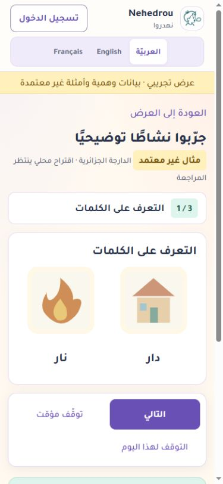

# Livraison des corrections du 30 octobre 2026

Le chantier actif est `E:\LocalCoderWorkspace\Nehdrou\outputs\nehdrou`. Ses pièces, rapports et fichiers de travail ont été transférés sur E: après comparaison SHA-256 ; les outils système et les données de Codex restent gérés par leur installation.

La [checklist A01–A17](CORRECTIONS_AUDIT_20261030.md) distingue corrections logicielles, préparation opérationnelle et décisions humaines. **Le périmètre demeure une démonstration avec données fictives.**

## Vérifications obtenues

- PostgreSQL local isolé : 430 tests réussis, aucun test ignoré, dont dix cas historiques et quatre nouveaux cas de concurrence ; 413,622 s.
- SQLite isolé : 416 réussis et 14 tests réservés à PostgreSQL, aucun échec ; 349,405 s.
- Après les retouches de sémantique/langue du sélecteur : cinq tests de langue et deux tests du vrai script de formulaires réussis. Ces contrôles sont distincts des suites de 430.
- Django, absence de dérive de migrations, 1 493 clés UI FR/EN/AR, syntaxe JavaScript et contrôle Git vérifiés.
- Les tests et rapports publics compacts se trouvent dans [verification-20261030](verification-20261030/postgresql-suite-summary.json). Les journaux complets et les secrets restent sur E: hors dépôt.
- Restauration chiffrée locale fictive PostgreSQL 17.11 réussie ; la durée de restauration locale ne constitue pas un RTO de production.

## Correctif complémentaire de livraison des preuves

Après les suites globales, un contrôle a reproduit une réouverture de fichier pouvant servir des octets différents de ceux contrôlés. La livraison des justificatifs lit désormais une fois au plus 15 Mio, vérifie les octets puis sert ce même contenu ; HEAD ne renvoie pas de corps. Les périmètres privés et la conservation des archives restent en place. Huit nouvelles régressions passent sous SQLite et le lot PostgreSQL affecté passe **74/74, sans échec ni test ignoré**. Les 430 tests globaux ne sont pas présentés comme rejoués après ce correctif. [Résumé complémentaire](verification-20261030/postgresql-evidence-delivery-summary.json).

## Publication et contenus

La première version corrigée `46fd30ebaecd7795d2128e31f7661f4ff9a31343` est devenue live sur Render le 30 octobre 2026. Les pages d’accueil, d’essai public, d’aide et de connexion ont répondu 200 dans les trois langues ; `/healthz/` répond 200 avec mesures app/SQL. [Résultats HTTP](verification-20261030/published-http-smoke.json).

Dix nouvelles versions MSA v2 ont été ajoutées avec parité FR/EN/AR proposée, sans avis ni ouverture. Le [lot de six concepts FR](GENERATED_IMAGE_REVIEW_PACK_20261030.md) est importé dans les médias privés : six PNG sources et douze WebP d’affichage, trois nouvelles versions v3. Une lecture de contrôle retrouve les dix révisions déjà présentes et les 18 fichiers intacts. Les versions antérieures sont conservées. Ces contrôles ne sont pas des essais de mutation sur une base de test publiée : ils accompagnent l’installation réelle de propositions en brouillon.

Fiches du CMS, réservées aux comptes autorisés :

- [pain / bain](https://nehedrou-demo.onrender.com/fr/editorial/f8b5490d-61be-474f-b756-626b337c8610/)
- [poule / boule](https://nehedrou-demo.onrender.com/fr/editorial/d08dc340-12b5-46cc-8601-96f9d2381beb/)
- [poire / boire](https://nehedrou-demo.onrender.com/fr/editorial/dec9bac6-58af-493a-8b4b-883451acbcbf/)

Inventaire éditorial en lecture seule, horodaté 17:56 UTC : **111 séries candidates, 124 versions réelles en brouillon et 125 versions de démonstration/historiques**, 23 médias téléversés (18 images et cinq audios), tous aux droits/validités inconnus. Les 222 emplacements audio des derniers candidats sont toujours vides. **Aucune activité réelle disponible, aucune preuve, approbation positive ou décision d’ouverture n’est ajoutée.** [Inventaire vérifiable](verification-20261030/published-inventory.json).

Les observations du navigateur de bureau confirment les premiers tests locaux AR (erreur/focus, pause/reprise, arrêt sans choix), le clavier FR et la mise en page aux largeurs 390/320. Ensuite les actions IAB ont cessé de produire un effet, y compris sur le bouton Suivant d’un onglet neuf. Aucun défaut serveur de sélection de langue n’est déduit de ce blocage. Le rendu publié AR et ses images ont été inspectés à 390 px ; les interactions publiées, le zoom réel à 200 %, les appareils physiques et les lecteurs d’écran restent à vérifier.

## Exploitation restant à accepter

Le service existant est conservé ; aucun Blueprint n’a été appliqué et aucune ressource payante créée. Le champ Render `healthCheckPath` reste vide : le réglage HTTP `/healthz/` attend une session opérateur connectée. La disponibilité de l’endpoint ne signifie pas que Render utilise déjà ce contrôle HTTP.

Une lecture SQL et une lecture d’image S3 existante ont réussi depuis le poste opérateur. Ce sont des échantillons individuels incluant le contexte réseau du poste, pas un benchmark Render/S3. Le contrôle SMTP fourni décrit les valeurs du processus opérateur, **pas l’environnement SMTP distant de Render** ; aucun courriel envoyé ou reçu n’est attesté.

Planification, destination de sauvegarde hors hébergeur, garde des clés, alertes et courriels restent à accepter/configurer. La revue automatique a refusé une copie complète de Neon sur E: faute d’autorisation explicite d’export des dossiers ; cette confirmation est encore attendue. Aucune sauvegarde complète ni restauration de la base publiée n’est déclarée.

Relectures cliniques/linguistiques, modèles vocaux natifs, familiarité des images, droits, finalité et cadre de pilote restent à documenter par les responsables compétents. Aucun tarif, contrat, avis humain ou bénéfice thérapeutique n’est inventé.

## Rendu publié inspecté

